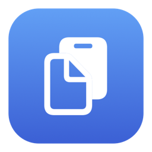

# PastePad



一款面向 macOS 的本地剪贴板工具，用快捷键找回复制过的文本和图片，也可以保存常用文本，按分组整理并快速粘贴。

**macOS 13+ · SwiftUI + AppKit · 本地存储 · 中英文界面**

## 功能

- **文本与图片历史**：自动记录新的复制内容，支持图片缩略图与放大预览。
- **搜索与整理**：搜索正文和备注，创建分组、移动条目、锁定常用内容。
- **快速复用**：点击内容粘贴回原应用；点击复制按钮只复制，面板保持打开并显示成功反馈。
- **手动新建**：保存多行文本，添加备注，选择分组；相同内容也可以保存为独立条目。
- **键盘与触控板操作**：快捷键唤起面板，方向键选择记录和切组，左右滑动切换分组。
- **可调节的记录策略**：按时间、条数和图片空间清理，支持暂停记录、排除应用、登录时启动和隐藏菜单栏图标。

界面跟随系统深浅色外观，并适配减少动态效果、减少透明度和增加对比度设置。macOS 26 及以上使用 Liquid Glass，较早版本使用系统毛玻璃。

## 安装与首次使用

1. 打开 `PastePad.dmg`，将 **PastePad** 拖入 **Applications（应用程序）**。安装包可通过下方的构建命令生成。
2. 从“应用程序”启动 PastePad。更新时先退出旧版，再替换应用。
3. 进入 **设置 → 隐私**，按界面提示允许剪贴板读取；如果系统询问访问方式，选择“始终允许”以持续记录。
4. 如需点击条目后自动粘贴，在 **系统设置 → 隐私与安全性 → 辅助功能** 中允许 PastePad。未授权时仍可复制条目，再手动粘贴。

启动时不会导入系统剪贴板中已有的内容，只记录之后发生的复制操作。

### 打开与复用

- 默认按 **⇧ ⌘ V** 打开或收起面板；打开位置为鼠标所在屏幕的可用区域中央。
- 点击菜单栏图标时，面板在图标下方打开。
- 输入关键词搜索正文和备注，点击条目尝试粘贴回唤起面板前的应用。
- 点击条目旁的复制按钮只复制内容。本次打开期间记录保持原位，下次打开时再按最近复制时间排序。

全局快捷键可在 **设置 → 通用** 中修改，每个按键独立显示。隐藏菜单栏图标后，仍可通过快捷键或重新打开应用唤起面板。

### 键盘操作

符号对应：`⌘` Command、`⇧` Shift、`⌥` Option、`⌃` Control。

| 操作 | 快捷键 |
| --- | --- |
| 打开 / 收起面板 | ⇧ ⌘ V（默认，可修改） |
| 选择上一条 / 下一条 | ↑ / ↓ |
| 切换分组 | ← / → |
| 粘贴当前记录 | Return |
| 复制当前记录 | ⌘ C（列表获得焦点时） |
| 预览当前图片 | Space（列表获得焦点时） |
| 新建文本条目 | ⌘ N |
| 保存新建条目 | ⌘ Return |
| 关闭面板或取消当前弹窗 | Esc |

搜索框为空时可直接按左右方向键切组；有搜索文字时，左右键保留光标移动功能，按 ↓ 进入列表后可切组。切组会保留搜索词，到边界后停止。新建条目中的 Return 用于换行。

## 历史保留与本地数据

默认限制均可在 **设置 → 历史记录** 中调整：

| 设置 | 默认值 |
| --- | --- |
| 未锁定记录保留时间 | 48 小时 |
| 未锁定记录数量 | 100 条 |
| 新图片单张上限 | 20 MB |
| 未锁定图片总空间 | 256 MB |

达到限制时优先清理较旧的未锁定记录。锁定条目不参与自动清理；解锁后重新计算保留时间。锁定记录仍可手动删除，清空未锁定历史会保留锁定条目和分组。

历史与图片保存在本机，可在设置中点击“查看本地数据”打开：

```text
~/Library/Application Support/Tapaste/
├── history.json
└── Images/
```

PastePad 原名 Tapaste。为兼容已有数据与设置，继续使用 `Tapaste` 数据目录和 `app.tapaste.mac` 应用标识；偏好设置通过系统 UserDefaults 保存。

### 隐私边界

应用无需账号，没有云同步或上传功能。默认跳过源应用标记为机密、临时、自动生成的内容及文件引用。

这些标记依赖源应用配合，**不能可靠识别未标记的密码、验证码等敏感内容**。按应用排除也依赖来源标记或采集时的前台应用，无法保证完整识别复制来源。历史文件未额外加密，处理敏感内容时建议暂停记录。

## 从源码构建

需要 macOS 和包含 **macOS 27 或更新 SDK** 的 Xcode。应用最低运行目标为 macOS 13；macOS 13/14 及不同系统外观仍需在对应系统实机验证。

```sh
git clone https://github.com/scplsy/pastepad.git
cd pastepad
bash scripts/build.sh
open build/PastePad.app
```

构建脚本会在未设置 `DEVELOPER_DIR` 时优先使用 `/Applications/Xcode.app`，并生成：

| 产物 | 用途 |
| --- | --- |
| `build/PastePad.app` | 可直接运行的应用 |
| `build/PastePad.zip` | 应用压缩包 |

生成拖拽安装的 DMG：

```sh
bash scripts/package.sh
```

打包脚本会先构建，再校验应用签名、创建并校验 `build/PastePad.dmg`。安装包包含 PastePad 和 Applications 快捷方式。当前脚本采用 **ad-hoc 本地签名**，未包含 Developer ID 签名或 Apple 公证流程。

源码目录、Xcode 工程和 scheme 仍名为 `Tapaste`，构建产物名为 `PastePad`。`build/`、Xcode 个人配置和派生文件已加入 Git 忽略规则。

## 测试

在项目根目录执行以下脚本：

| 命令 | 覆盖范围 |
| --- | --- |
| `bash scripts/test-store.sh` | 持久化、去重、清理、锁定、分组、图片与手动创建，共 13 项 |
| `bash scripts/test-hotkey.sh` | 全局快捷键注册、冲突、失败回滚与资源释放，共 5 项 |
| `bash scripts/test-group-swipe.sh` | 手势方向、阈值、惯性过滤与连续切组，共 6 组 |
| `bash scripts/test-presentation-order.sh` | 复制保持原位、新记录置顶、删除与重新打开后的排序，共 4 组 |
| `bash scripts/test-panel-presentation.sh` | 开合反向、过期回调、重复请求与快速切换，共 5 组 |

存储测试使用独立的临时目录和偏好设置域。快捷键测试会短暂预留 `⌃ ⌥ ⇧ ⌘ F18` 和 `⌃ ⌥ ⇧ ⌘ F19`，不发送按键；组合不可用时以退出码 `77` 跳过。其余交互逻辑测试不操作桌面。这些测试不读取真实剪贴板历史。

## 常见问题

- **快捷键无法唤起**：检查是否与其他应用冲突，在设置中选择另一组快捷键；修改失败时原快捷键仍然有效。
- **没有记录新内容**：检查是否暂停记录、来源应用是否被排除，以及剪贴板读取权限。申请读取权限时，可先复制一段非敏感文本，再点击“允许读取”。
- **可以复制，但不能自动粘贴**：检查辅助功能权限及目标应用焦点，也可在目标应用中按 ⌘ V 手动粘贴。
- **更新后仍提示辅助功能未授权**：系统可能保留旧构建的授权。可移除旧条目，再添加实际运行的应用；按上述方式安装时为 `/Applications/PastePad.app`。

## 项目结构

```text
Tapaste/             SwiftUI 界面、AppKit 集成、剪贴板服务与本地存储
Tapaste.xcodeproj/   Xcode 工程
Tests/              存储与交互逻辑测试
scripts/            构建、DMG 打包与测试脚本
```

## 许可证

本项目采用 [MIT License](LICENSE)。使用、修改或分发时，请保留版权声明和许可证。
